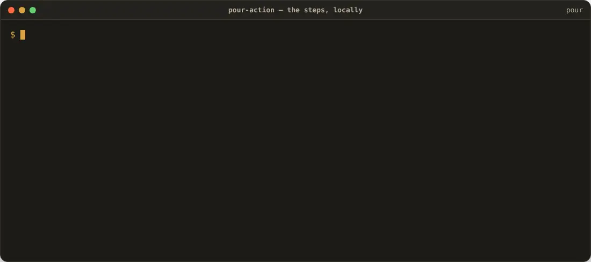
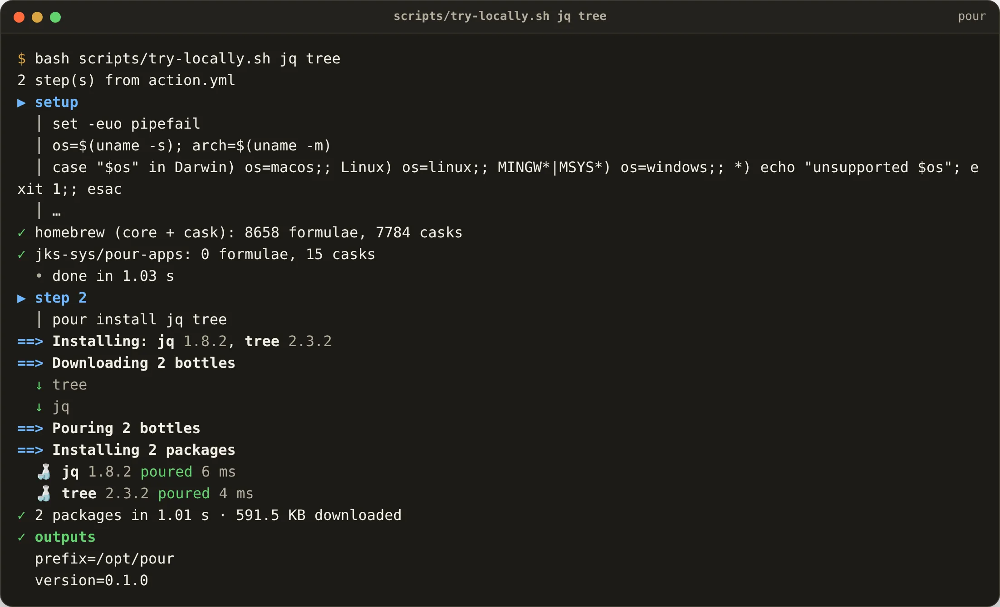
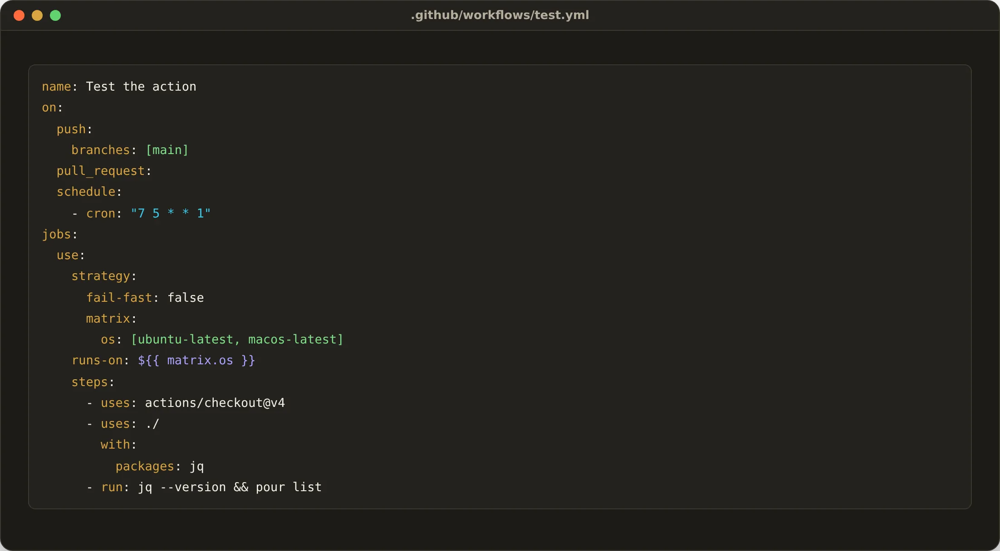

<p align="center">
  <picture>
    <source media="(prefers-color-scheme: dark)" srcset="docs/pour-dark.svg">
    
  </picture>
</p>

<h1 align="center">pour-action</h1>

<p align="center"><strong>Install <a href="https://github.com/JKS-sys/pour-13-Oct-2026">Pour</a> and your packages in CI, in seconds.</strong></p>

```yaml
- uses: JKS-sys/pour-action-13-Oct-2026@v1
  with:
    packages: jq ffmpeg wget
```

That is the whole step: it downloads the `pour` build for the runner (macOS arm64/x86_64, Linux x86_64/arm64, Windows), creates `/opt/pour`, fetches the registry and pours the packages — every bottle in parallel, from Homebrew's own build farm.

## See it move

### The action's steps, run on Ubuntu

`scripts/try-locally.sh` reads `action.yml`, fills in the inputs and runs the very same steps a runner executes: download the `pour` build for the machine, put it on `PATH`, fetch the registry, pour the packages. Here with `packages: jq tree`.



[▶ Watch with sound (MP4)](docs/demo-action.mp4)

<table>
<tr>
<td><br><sub>The setup step: `pour update` fetches the index of every formula and cask, then `pour install jq tree` pours them — the output a runner's log shows.</sub></td>
<td><br><sub>A matrix workflow: the same step on macOS and Linux runners, then the installed tools in use.</sub></td>
</tr>
</table>

## Try it on your machine

```sh
bash scripts/try-locally.sh jq tree        # the steps, with GITHUB_PATH / GITHUB_ENV wired like Actions
```

## Inputs

| Input | Default | What |
|---|---|---|
| `packages` | | formulae to install, space separated |
| `casks` | | casks (macOS apps) to install |
| `brewfile` | | a Brewfile to install with `pour bundle` |
| `version` | `latest` | Pour version |
| `prefix` | `/opt/pour` (`$RUNNER_TEMP/pour` on Windows) | where Pour lives |

Outputs: `prefix`, `version`. `pour` is on `PATH` for every later step, and `POUR_PREFIX` is set.

## Examples

```yaml
jobs:
  build:
    strategy:
      matrix: { os: [ubuntu-latest, macos-latest] }
    runs-on: ${{ matrix.os }}
    steps:
      - uses: actions/checkout@v4
      - uses: JKS-sys/pour-action-13-Oct-2026@v1
        with:
          brewfile: Brewfile
      - run: ffmpeg -version
```

```yaml
      - uses: JKS-sys/pour-action-13-Oct-2026@v1
        with:
          casks: peek          # the creator's apps work too (macOS runners)
```

Pour never touches `/opt/homebrew`, so the runner's Homebrew stays as it was.

<!-- licence -->
## Licence

Copyright © 2026 **Jagadeesh Kumar S**. All rights reserved. Source-available under the [Pour licence](https://github.com/JKS-sys/pour-13-Oct-2026/blob/main/LICENSE).
<!-- /licence -->
